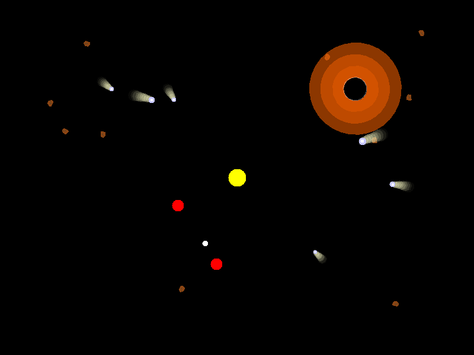

# Galaxy Simulation

A Java Swing simulation of a small galaxy. Build a galaxy from a console menu by adding stars, planets, moons, asteroids, comets, and black holes, then launch an animated window where objects orbit, collide, and respond to gravitational pull.

Originally built as a team final project for CIS 142 at Edmonds College in Spring 2025, the project was revisited in October 2026 to restore the complete source, fix a long-standing collision problem, and add automated validation.



## What it does

1. **Build a galaxy** — use a console menu to add celestial objects within defined limits.
2. **Create orbital systems** — planets orbit a star, and moons follow a moving planet.
3. **Animate independent motion** — asteroids and comets enter from the edges and travel through the simulation.
4. **Model interactions** — moving objects collide with each other and bounce off stars, planets, and moons.
5. **Simulate black holes** — nearby asteroids and comets experience gravitational pull and are destroyed after crossing the event horizon.
6. **Render the result** — a Java Swing interface updates and redraws the simulation on a timer.

## Clone and run locally

**Prerequisites:**

- Git
- Java Development Kit (JDK) 17 or later
- A desktop environment capable of displaying a Java Swing window

Confirm that both Java commands are available:

```text
java -version
javac -version
```

### Windows PowerShell

```powershell
git clone https://github.com/EmmaBlueJeans/SolarSystem.git
cd SolarSystem
New-Item -ItemType Directory -Force out | Out-Null
javac -d out (Get-ChildItem src -Filter *.java).FullName
java -cp out GalaxyMain
```

### macOS or Linux

```bash
git clone https://github.com/EmmaBlueJeans/SolarSystem.git
cd SolarSystem
mkdir -p out
javac -d out src/*.java
java -cp out GalaxyMain
```

If Git is unavailable, use GitHub's **Code → Download ZIP** option, extract the archive, open a terminal in the extracted folder, and begin with the appropriate compile command above.

### Using the simulation

1. Use the numbered console menu to add celestial objects.
2. Add at least one star before adding planets or launching the simulation.
3. Add a planet before adding moons.
4. Select **7. Simulate Current Galaxy** to open the animated Swing window.
5. Closing the visualization window exits the application.

## How it is built

| Class | Role |
| --- | --- |
| `Celestial` | Base class containing position, mass, size, lifecycle state, `update()`, and `draw()` |
| `Orbit` | A `Celestial` that moves in a circle around a center point |
| `Star`, `Planet`, `Moon` | Stars remain fixed, planets orbit a star, and moons follow a planet |
| `Movable` | Shared velocity contract used by asteroids and comets |
| `Asteroid`, `Comet` | Enter from the display edges, move independently, and respond to collisions |
| `BlackHole` | Pulls nearby moving objects and destroys anything that crosses its event horizon |
| `GalaxySimulation` | Model that stores every object, advances each tick, applies gravity, and resolves collisions |
| `GalaxyGUI` | Swing view and timer that asks each object to draw itself |
| `GalaxyMain` | Console menu for constructing the galaxy and launching the GUI |
| `CollisionBehaviorTest` | Deterministic regression checks for key collision scenarios |

The architecture follows a model/view split. `GalaxySimulation` manages state and interactions without handling presentation, while `GalaxyGUI` renders the current model without owning the simulation rules. Individual object classes define their own movement and appearance.

## Team contributions

- **Ruth:** `GalaxyMain` and the console menu
- **Kaitlyn:** the `Celestial` class hierarchy, orbit behavior, planets, and moons
- **Emma:** `GalaxyGUI`, `GalaxySimulation`, and integration of the project components

Emma later revisited the integrated project to restore the complete source, repair collision behavior, add regression checks, reorganize the repository, and document the engineering decisions.

## Testing

GitHub Actions compiles the complete project with JDK 17 and runs deterministic checks for:

- Asteroid–comet collisions regardless of list order
- Incoming objects bouncing off fixed or orbiting bodies
- Fast, head-on objects being detected between animation frames
- Collision separation preventing objects from remaining overlapped

Run the same checks locally with:

```bash
javac -d out src/*.java tests/*.java
java -cp out CollisionBehaviorTest
```

## Decisions and lessons learned

### 1. Sharing code across different IDEs

**Problem:** Team members used different editors, including VS Code and NetBeans, and were new to Git. IDE-specific project structures made it difficult to move changes cleanly between machines, while learning GitHub became a project challenge of its own.

**Lesson:** Agree on the repository layout and contribution workflow before development begins. An IDE-neutral `src/` layout, command-line build instructions, and shared `.gitignore` allow the same project to work consistently across editors. A short guide explaining how to pull, commit, and push would also reduce integration friction.

### 2. Integrating components built on different assumptions

**Problem:** The orbital mechanics were well developed, but they used a different movement model from asteroids and comets. Planets and moons follow a predetermined center, radius, and angle, while incoming objects move using velocity. That difference made the components harder to combine in one update loop, particularly when collisions were introduced.

**Lesson:** Define shared responsibilities and interfaces before dividing the work, then integrate small pieces early. The later `Movable` interface provided a common contract for objects with changeable velocity without forcing orbiting objects into an unsuitable model.

### 3. Redesigning collision handling

**Problem:** Comets and asteroids passed through stars, planets, and moons, while comet–asteroid collisions did not occur reliably.

The original implementation had several interacting causes:

- Collision branches covered only a few type combinations.
- The comet–asteroid condition depended on which object appeared first in the list.
- Orbiting objects had no velocity that the original bounce logic could exchange.
- Objects could cross between animation frames without overlapping at either endpoint.
- Objects left overlapping after a collision could repeatedly bounce and appear stuck.

**Approach:**

- Added `Movable` so asteroids and comets use a shared, order-independent collision path.
- Treated stars, planets, and moons as effectively immovable during impact: an incoming object bounces away while the orbiting object remains on its track.
- Used the orbiting object's measured movement during the frame when calculating the incoming object's response.
- Added a swept closest-approach check to reduce missed collisions when objects cross between animation frames.
- Applied collision response only when objects are approaching and repositioned them after impact to prevent repeated overlap and jitter.
- Added deterministic regression checks for ordering, impacts with fixed bodies, fast head-on movement, and post-impact separation.

**Result:** The previously missing collision paths now behave consistently, and the critical cases are checked automatically on every push through GitHub Actions.

### 4. Restoring and validating an older project

**Problem:** The public repository contained only part of the source and did not compile. In addition, `BlackHole.draw(Graphics2D)` was marked as an override even though the parent class declared `draw(Graphics)`.

**Approach and lesson:** The complete source was recovered and compared with the repository before anything was replaced. The drawing method was corrected to accept `Graphics` and cast it internally to `Graphics2D`. Source files were organized under `src/`, obsolete drafts were removed from the current tree while remaining available in Git history, and a GitHub Actions workflow was added.

Returning to older software is not only a cleanup exercise. It requires establishing what the authoritative version is, reproducing failures, making narrowly scoped corrections, and adding enough documentation and automated validation that another developer can work with it.

## Known limitations and future ideas

- Stars, planets, and moons remain on predetermined tracks; impacts redirect the incoming object but do not alter an orbit.
- Multi-object pileups are resolved one pair at a time and can still produce imperfect results in rare crowded interactions.
- New planets orbit the first star, and new moons orbit the first planet.
- Asteroids and comets that leave the display are not removed.
- The GUI timer runs every 100 milliseconds. A shorter interval could produce smoother animation.
- Black-hole gravity is intentionally simplified and primarily noticeable at close range.
- Console input expects a valid number and does not recover from non-numeric input.
- The project does not currently have a browser-based demonstration.

## Project status

The original team project has been preserved and refined as a portfolio project. It now compiles automatically, includes deterministic collision checks, documents the design and repair process, and implements its main object, orbit, collision, gravity, and rendering behaviors.
